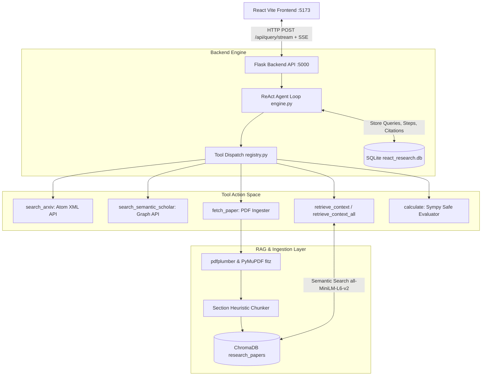

# ReAct: Synergizing Reasoning and Acting in Language Models
## Architecture & Technical Specification

This document provides an in-depth technical breakdown of the **Automated Academic Research Assistant**, built to reproduce and demonstrate the core paradigm of **ReAct (Reasoning + Acting)** from Yao et al. (ICLR 2023), applied to reading, retrieving, cross-checking, and calculating over full-text scientific literature.

---

## 1. System Overview & Decoupled Design

The application is structured as a decoupled full-stack interactive web application:
- **Backend (`/backend`)**: A Python Flask REST API and Server-Sent Events (SSE) streaming engine. It manages local ChromaDB vector indexing, relational SQLite trajectory/citation storage, external API integrations (arXiv, Semantic Scholar), and the Anthropic Claude tool-calling loop.
- **Frontend (`/frontend`)**: A React 18 single-page application built with Vite and modern CSS (glassmorphism, micro-animations, distinct color coding). It consumes real-time SSE streams to render reasoning traces step-by-step and provides interactive comparison toggles across ablation modes.



---

## 2. The ReAct Loop Implementation (`engine.py`)

The core engine implements an explicit alternation between internal reasoning (`Thought`) and external environmental interactions (`Action -> Observation`).

### 2.1 Execution Flow
1. **User Query Ingestion**: When a user submits a query, a `Query` record is created in SQLite with the selected `mode` (`react`, `cot`, `act`, or `standard`).
2. **LLM Invocation**: The Anthropic Claude API (`claude-3-7-sonnet-20250219` / `claude-3-5-sonnet-20241022`) is invoked with specialized system instructions enforcing strict `Thought -> Action -> Observation` syntax and full-content citation formatting.
3. **Thought Streaming**: Any textual reasoning blocks (`content.type == "text"`) generated by Claude prior to invoking tools are yielded immediately via Server-Sent Events as `thought` items and persisted to `TrajectoryStep` in SQLite.
4. **Action Dispatch**: When Claude emits tool call blocks (`content.type == "tool_use"`), the engine yields an `action` event with the tool name and JSON arguments.
5. **Observation Capture**: The tool executes, capturing external findings (e.g., academic paper abstracts, RAG prose passages, Sympy math results). The output is yielded as an `observation` SSE event, persisted to `TrajectoryStep`, and fed back into Claude's message history (`tool_result`).
6. **Iteration & Termination**: Steps 2–5 repeat until the model calls `finish(answer)` or reaches the `MAX_STEPS` safety limit (default 10). Upon completion, all `(paper_id, page X)` citations are regex-extracted and recorded in the `Citation` table.

---

## 3. Tool Dispatch Logic (`registry.py`)

The agent operates over an explicit action space corresponding to Yao et al.'s task definitions:

| Action | Input Schema | Execution Behavior & Edge Case Handling |
| :--- | :--- | :--- |
| `search_arxiv` | `query: str` | Queries `export.arxiv.org/api/query` Atom XML. Uses a thread-safe rate limiter (max 1 req / 3s) and extracts `atom:id`, `atom:title`, `atom:summary`, publication year, authors, and PDF mirror URLs. |
| `search_semantic_scholar` | `query: str` | Queries `api.semanticscholar.org/graph/v1/paper/search`. Explicitly checks `openAccessPdf`. If null, surfaces a descriptive observation advising the agent that full-text download is unavailable and only abstract metadata can be reasoned over. |
| `fetch_paper` | `paper_id: str`, `pdf_url: str`, `title: str` | Downloads the PDF to `/backend/data/pdfs/`. **Idempotent**: checks SQLite (`Paper`) and ChromaDB (`research_papers`) first; if already indexed, returns immediately without re-downloading. |
| `retrieve_context` | `paper_id: str`, `query: str` | Semantic vector search scoped to `where={"paper_id": paper_id}`. Returns top-k passages with heading heuristics (`section_guess`) and exact page numbers (`page_number`). |
| `retrieve_context_all` | `query: str` | Unscoped semantic vector search across all indexed research papers in the session. Enables cross-paper synthesis and claim comparison across multiple papers. |
| `calculate` | `expression: str` | Uses `sympy.parsing.sympy_parser.parse_expr` and `evalf()` for safe algebraic and numeric computation. **Never uses raw Python `eval()`**, preventing remote code execution or crashes on malformed math. |
| `finish` | `answer: str` | Terminates the loop, yielding the final synthesized markdown report with explicit inline citations. |

---

## 4. Full-Text RAG Ingestion Layer (`pdf_ingester.py` & `vector_store.py`)

To fulfill the core requirement of **full-content retrieval over prose** (not just abstracts/numbers), the ingestion pipeline performs multi-modal parsing and semantic chunking:

### 4.1 Hybrid PDF Parsing
When `fetch_paper` runs, `pdfplumber` attempts page-by-page text extraction (`page.extract_text()`). If a PDF exhibits malformed character mappings or structural anomalies, the ingester automatically falls back to **PyMuPDF (`fitz`)**. If zero text pages are extracted (scanned/image-only PDF), an explicit error is returned to the agent observation so it can adapt its reasoning plan.

### 4.2 Section Heading Heuristics & Chunking
Text lines are scanned using regex patterns matching standard academic heading conventions:
- `Abstract`, `Introduction / Background`, `Related Work`, `Methodology / Proposed Method`, `Experiments & Setup`, `Results & Discussion`, `Discussion & Limitations`, `Conclusion`, `References`.

Prose is segmented into ~350-word chunks with 50-word overlaps. Each chunk is enriched with structured metadata:
```json
{
  "paper_id": "2210.03629",
  "paper_title": "ReAct: Synergizing Reasoning and Acting in Language Models",
  "page_number": 3,
  "section_guess": "Methodology",
  "chunk_index": 4
}
```

### 4.3 Local Zero-Cost Vector Storage
Chunks are embedded using **`sentence-transformers` (`all-MiniLM-L6-v2`)** running locally, avoiding API latency and cost. Embeddings are stored in a persistent local **ChromaDB** collection (`/backend/data/chroma/`). A single predictable helper (`get_or_create_collection("research_papers")`) ensures zero scattering or connection contention.

---

## 5. Comparative Ablation Modes (Demo Centerpiece)

A key educational and analytical centerpiece of this application is live support for **4 Ablation Modes**, reproducing the comparative behavior documented in Yao et al. (2023):

1. **`ReAct` Mode (`Thought -> Action -> Observation`)**: The agent dynamically alternates internal reasoning and external action. By retrieving exact passages via `retrieve_context` and verifying numbers via `calculate`, it eliminates hallucination and grounds every claim in verified full-text literature.
2. **`CoT-only` Mode (Chain of Thought without Actions)**: The agent is restricted from calling external tools. It must reason step-by-step (`Thought: ...`) relying solely on internal pre-trained weights. When tested on complex queries, this mode demonstrates **factuality hallucination** and stale citations—proving why external acting (`Action -> Observation`) is essential.
3. **`Act-only` Mode (Actions without Reasoning Traces)**: The model executes tool calls directly (`Action -> Observation`) without writing intermediate scratchpad thoughts (`Thought`). This demonstrates how acting without intermediate reasoning traces leads to unguided search, redundant queries, and difficulty synthesizing multi-step answers.
4. **`Standard` Mode (Zero-Shot Direct Answer)**: Direct parametric generation without tools or Chain-of-Thought steps.

---

## 6. Safety & Reliability Guardrails

### 6.1 Repetition Guard
A documented failure mode in the original ReAct paper is **reasoning loops**, where an agent repeatedly calls the exact same tool with the exact same arguments when an observation is unhelpful or empty.
Our engine tracks `(tool_name, tool_args_json)` across consecutive steps. If a duplicate call is detected, the engine blocks execution and injects a high-priority intervention observation:
> *"Observation Repetition Guard: You just executed tool `search_arxiv` with identical arguments... To prevent reasoning loops (as documented in Yao et al.), you MUST NOT repeat this action. Please formulate a new Thought, adapt your query, or invoke finish(answer)."*

### 6.2 Stopping Condition (Step Limit)
To prevent infinite budget burn on complex or ambiguous tasks, the loop enforces a strict threshold (`MAX_STEPS = 10`). If step 10 is reached without `finish(answer)`, the engine terminates gracefully, summarizes the latest reasoning observations, and returns the accumulated trajectory to the user.

---

## 7. Known Limitations & Scope Boundaries

1. **arXiv Full-Text Search Limitations**: The arXiv Atom XML API (`http://export.arxiv.org/api/query`) searches metadata (title, abstract, authors) efficiently, but does not index full body prose across the entire arXiv repository. Full-text semantic search becomes available immediately once `fetch_paper` is called on specific candidate IDs.
2. **PDF Parsing Edge Cases**: Scanned, two-column math-heavy, or image-only PDFs without OCR text layer will fail both `pdfplumber` and `PyMuPDF` text extraction. The system surfaces a descriptive error for such papers.
3. **External API Rate Limits**:
   - **arXiv**: Enforces a strict etiquette limit of $\le 1\text{ request} / 3\text{ seconds}$. Handled via thread-safe mutex and queueing delay (`config.RATE_LIMIT_DELAY`).
   - **Semantic Scholar Graph API**: Public free tier is subject to rate limiting (`HTTP 429`). When encountered, our client catches the 429 and instructs the agent to fall back to `search_arxiv`.
4. **SQLite Schema Evolution**: For assignment scope, SQLite is used directly via SQLAlchemy (`db.create_all()`) without an active migration tool like Alembic. If model columns are altered during development, run `python init_db.py` on a clean storage directory or delete `react_research.db` before re-initializing.
